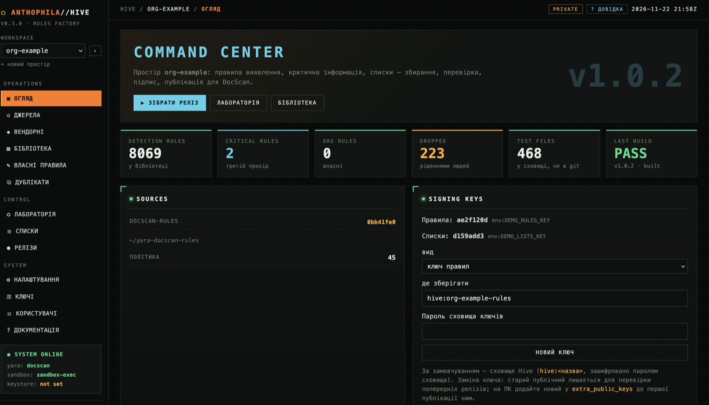
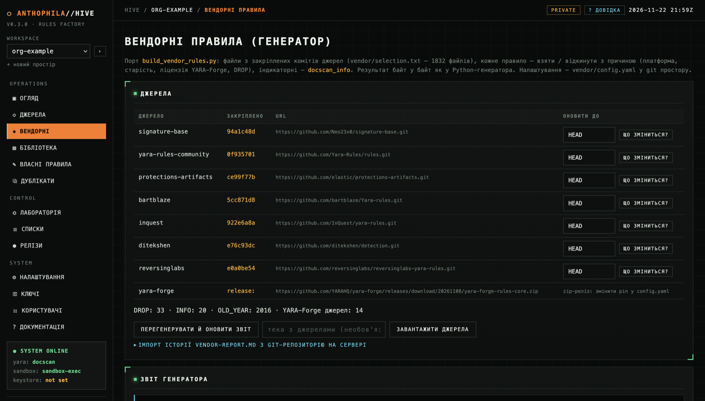
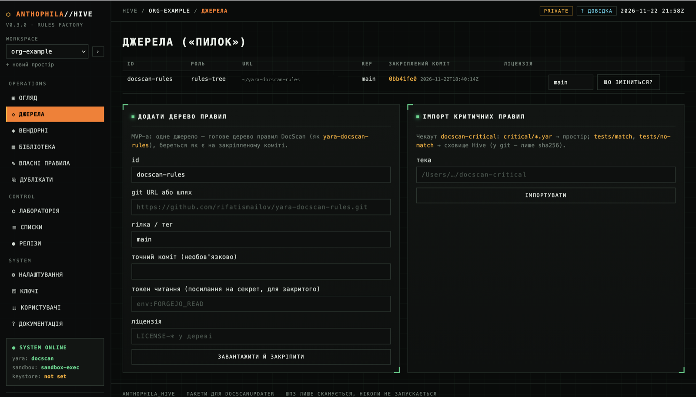

# Anthophila_Hive

Фабрика правил для [DocScan](https://github.com/rifatismailov/yara-docscan). Сервіс збирає правила виявлення
(YARA), правила критичної інформації і білі / чорні списки організації, тестує їх і публікує **підписаний пакет**
у форматі, який уже вміє ставити служба DocScanUpdater. Сама програма DocScan при цьому не змінюється.

Кожна організація розгортає **свій** Hive на своєму сервері (Linux + Docker) і керує правилами через веб-інтерфейс:
кілька людей з ролями, «чотири ока» на публікацію, ключі підпису — у зашифрованому сховищі.

План і рішення: [docs/PLAN.md](docs/PLAN.md) · розгортання: [docs/DEPLOY.md](docs/DEPLOY.md) · довідка для
користувачів — сторінка «Документація» у самому веб-інтерфейсі.

## Вигляд

**Огляд простору** — командна панель: показники бібліотеки, останнє збирання, джерела, ключі підпису, цілі, журнал.



**Вендорні правила** — генератор (порт `build_vendor_rules.py`, результат байт у байт): джерела на закріплених
комітах, «що зміниться?» перед оновленням, звіт і його історія.



**Джерела** — дерево правил на закріпленому коміті, імпорт критичних правил з тестовими документами.



## Стан

**Етап 0 — готово:** перевірка пакета правил (контракт DocScan). Код, що вирішує як ПК, — дослівні копії пакетів
DocScan (`internal/docscan/`, див. [VENDORED.md](internal/docscan/VENDORED.md)) і порт шляху встановлення
updater-а (`internal/docscan/install`).

**MVP-a — готово:** робочі простори (git), ключі (Keychain / змінні середовища / KeePassXC), джерело-дерево правил
із закріпленим комітом, імпорт `yara-docscan-rules`, `docscan-critical` (з тестовими документами) і списків,
бібліотека з рішеннями, редактор власних правил з компіляцією DocScan і лінтером кирилиці, тести правил на файлах,
списки з перевіркою й підписом, збирання з контрактом і критичними тестами, публікація в теку / UNC, гілку дзеркала
і списки, відтворення релізу; CLI і веб-інтерфейс.

Приймальний тест MVP: з `yara-docscan-rules@d2fdc4f` Hive збирає ті самі 1 667 файлів з тими самими sha256, що
офіційний реліз v1.0.0 (крім `VERSION.txt`) — `TestSameFilesAsOfficialRelease`.

**MVP-b — готово:** лабораторія (набори за посиланням або копією; кандидат проти попереднього релізу на тих самих
файлах у пісочниці ОС; червоні пункти G1–G7; прийняття перевірених спрацювань; звіти назавжди; публікація
заблокована, поки прогін червоний), дублікати L0 / L1 / L4 (з переглядом перед масовим відкиданням), керування
простором у веб-інтерфейсі (цілі, версія на ПК, відтворення релізу, перевірка будь-якого пакета), заміна ключа з
історією публічних ключів.

**Етап 2 — готово:** генератор вендорних правил на Go (порт `build_vendor_rules.py`, налаштування — дані в git
простору; результат **байт у байт** як у Python: 1 665 файлів `yara-docscan-rules`), джерела з закріпленими
комітами і кешем, оновлення джерела з різницею по правилах і впливом на згенерований набір, історія
`vendor-report.md` (статус кожного правила в кожній версії), схожі правила L2 і варіанти L3, реліз на GitHub /
Forgejo (з комітом дерева правил, як `yara-docscan-rules`).

**Етап 3 — готово: сервер організації.** Кожна організація розгортає свій Hive (Linux + Docker) і керує правилами
через веб: вхід (пароль argon2id + TOTP), ролі viewer / editor / reviewer / publisher / admin, «чотири ока» на
публікацію, сховище ключів (зашифроване паролем, розблоковується людиною на час дії), HTTPS, резервна копія.
Розгортання — [docs/DEPLOY.md](docs/DEPLOY.md).

Далі — етап 4: свій набір поверх підписаного публічного (Anthophila / DocScan), чужі списки з перевіркою підпису;
етап 5 — Windows-агент лабораторії, профілювання повільних правил.

## На сервері організації

```sh
docker compose -f deploy/docker-compose.yml up -d --build
docker compose -f deploy/docker-compose.yml exec hive hive user add --name admin --role admin
docker compose -f deploy/docker-compose.yml exec hive hive keystore init
# далі — https://<сервер>:8740/  (docs/DEPLOY.md)
```

## Швидкий старт (CLI, машина розробника)

```sh
go build -o bin/hive ./cmd/hive
export HIVE_YARA=~/yara/yara HIVE_YARAC=~/yara/yarac       # DocScan, не Homebrew
# дані Hive: ~/.anthophila-hive (або HIVE_DATA) — поза git: там зразки й документи

bin/hive init --name org-example --floor v1.0.0             # floor — офіційна версія, що вже стоїть на ПК
bin/hive key new --kind rules --ref keychain:anthophila-hive/org-example-rules
bin/hive key new --kind lists --ref keychain:anthophila-hive/org-example-lists
bin/hive source add --id docscan-rules --url https://github.com/rifatismailov/yara-docscan-rules.git --ref main
bin/hive import critical --repo ~/docscan-critical          # critical/*.yar + tests/ (документи — у сховище)
bin/hive import list --kind white --file whitelist.json
bin/hive target add --id share --kind folder --path '\\server\docscan\rules'
bin/hive target add --id lists --kind lists-folder --path '\\server\docscan\lists'

bin/hive build                                              # пакет, підпис, контракт, tests/match і tests/no-match
bin/hive publish --version v1.0.1 --target share            # лише з терміналу: треба ввести версію
bin/hive lists publish --target lists
bin/hive reproduce --version v1.0.1                         # зібрати заново і звірити кожен файл

bin/hive user add --name admin --role admin                 # перший користувач веб-інтерфейсу
bin/hive serve                                              # http://127.0.0.1:8740/ (на мережі — лише HTTPS)
```

### Вендорні правила (генератор)

```sh
bin/hive vendor import --script ~/yara-docscan-rules/tools/build_vendor_rules.py \
     --selection ~/yara-docscan-rules/tools/vendor-selection.txt --from ~/yara/docscan-project/vendor-sources
bin/hive vendor update --source signature-base --ref HEAD     # різниця по правилах, вплив на набір; потім закріпити
bin/hive vendor history --import --repo ~/yara --path docscan-project/rules/tools/vendor-report.md
bin/hive vendor history --rule INDICATOR_OLE_RemoteTemplate    # статус правила в кожній версії звіту
bin/hive target add --id gh --kind release --forge github --project <owner>/<repo> --public \
     --commit-tree --repo https://github.com/<owner>/<repo>.git --branch main --token keychain:anthophila-hive/gh
```

### Лабораторія і дублікати

```sh
bin/hive lab set add --id corpus  --kind clean   --path ~/docscan-ci/assets      # чисті документи (за посиланням)
bin/hive lab set add --id malware --kind malware --path ~/docscan-ci/malware     # ШПЗ: лише сканування
bin/hive lab set add --id sensitive --kind critical-labelled --path ~/docscan-test-dataset-v2   # expected.tsv
bin/hive lab config --sets corpus,malware,sensitive          # обов'язкові перед публікацією
bin/hive lab run --candidate v1.0.2                          # проти останнього опублікованого; --baseline vX | none | bundle
bin/hive lab accept --id 3 --key 'G2|Rule|…|sha256' --reason "перевірено: …"

bin/hive dupes                                              # групи L0 / L1 / L2 / L3 / L4
bin/hive dupes drop-in --pattern general/yara-rules-core.yar  # показує план, просить ввести кількість
```

Пункти звіту: G1 нові попередження `yarac` (повільні правила) · G2 нові спрацювання на чистих документах ·
G3 втрачені виявлення на ШПЗ · G4 критичні `match` / `no-match` · G5 критичні по категоріях (розмічений набір) ·
G6 помилки сканування (ворожі файли) · G7 швидкість. Червоне блокує публікацію; людина може прийняти конкретне
спрацювання з причиною (`lab/accepted.yaml` у git простору, діє, доки тіло правила те саме).

На ПК організації: публічна частина ключа правил — у `updater.json` → `extra_public_keys`, ключа списків — у
`lists.public_keys`; `rules.mirror.url` / `lists.url` — тека, у яку публікує Hive.

**Закрита гілка дзеркала для правил** (`mirror-branch` приватного простору) заблокована, поки ПК не мають DocScan з
`rules.mirror.token` (PLAN.md 9.1, Q1) — до того приватні набори публікуються в теку / UNC-шару з ACL. Після
оновлення ПК — `--pcs-token-supported` у цілі.

## Потрібно

- Go 1.25+, git
- **DocScan** `yara` / `yarac` (форк YARA 4.6 з модулем `docscan`). Звичайна yara не підходить: вона не скомпілює
  `docscan-policy.yar` і не має третього проходу. Hive перевіряє це при старті і відмовляється працювати зі
  звичайною yara.

## Перевірити пакет правил

```sh
go build -o bin/hive ./cmd/hive
export HIVE_YARA=~/yara/yara HIVE_YARAC=~/yara/yarac        # DocScan, не Homebrew

bin/hive verify -newer-than v1.0.0 DocScan-rules-bundle.zip               # bundle для ручного встановлення
bin/hive verify ci-out/rules-release-v1.0.1/                              # тека релізу (+ звірка з bundle)
bin/hive verify https://github.com/rifatismailov/yara-docscan-rules/releases/download/v1.0.0
bin/hive verify -key ed25519:<ключ організації> -token-env MIRROR_TOKEN https://forgejo.example/org/mirror/raw/branch/docscan-rules
```

Код завершення: `0` PASS, `1` FAIL, `2` INCOMPLETE (щось не перевірено, наприклад не задано DocScan yara чи
`-newer-than`) або помилка. `-json` виводить звіт у JSON.

Ключі: `-key` — ті, що стоять на ПК цілі в `extra_public_keys`; без `-key` — ключ CI DocScan
(`manifest.OfficialKeys`). Токен закритого дзеркала передається лише назвою змінної середовища (`-token-env`);
адреса з токеном усередині (`https://user:token@…`) відхиляється, бо такий токен потрапив би в журнал updater-а і
в Wazuh.

| Перевірка | Що | Звідки правило |
|---|---|---|
| R01 | склад bundle: рівно `rules-manifest.json`, `.sig`, пакет | `installRulesFile` |
| R02 | маніфест ≤ 4 МіБ, підпис ≤ 4096 Б | ліміти служби |
| R03 | підпис ed25519 довіреним ключем, продукт `docscan-rules`, формат маніфесту | `manifest.VerifyProduct` |
| R04 | розмір і sha256 пакета | `stageRules` |
| R05 | кожен файл zip — у маніфесті, sha256 збігається, усі файли маніфесту є, ≤ 4 ГіБ | `unpackVerified` |
| R06 | `docscan-index.yar` у корені | `stageRules` |
| R07 | версія в першому рядку `VERSION.txt` = версія маніфесту (з нього ПК знають, що встановлено) | `installedRules` |
| R08 | `critical/`: лише `NAME.yar` верхнього рівня, 1..256 файлів, ≤ 64 МБ разом | `cirun`, `yara --critical-rules` |
| R09 | назви критичних правил унікальні в усіх файлах (у Wazuh і в черзі — лише назва) | CRITICAL-RULES.md |
| R10 | компіляція DocScan `yarac` із зовнішніми змінними DocScan | `compileRules` |
| R11 | компіляція `critical/` DocScan `yara --critical-rules` | `compileCritical` |
| R12 | версія новіша за ту, що на цілі | `Compare` у службі |
| R13 | bundle поруч несе ті самі три файли | — |

## Тести

```sh
go test ./...                                               # без DocScan: контракт на синтетичних і зіпсованих пакетах
HIVE_YARA=~/yara/yara HIVE_YARAC=~/yara/yarac go test ./... # + справжня компіляція DocScan
HIVE_RELEASE_DIR=<тека з файлами релізу> go test ./internal/contract/ -run RealRelease   # справжній реліз і його зіпсовані копії
```

## Безпека

- Hive лише сканує: прапори yara, що лікують, пишуть файли чи вимикають пісочницю, заборонені в коді
  (`internal/yaraexec`).
- Зразки ШПЗ і документи замовників ніколи не потрапляють у git.
- Ключі підпису й токени — лише зі сховища секретів (KeePassXC, змінні середовища, системне сховище ключів).

`context/` — довідкові копії коду й документів DocScan (окремий Go-модуль, Hive їх не збирає).
