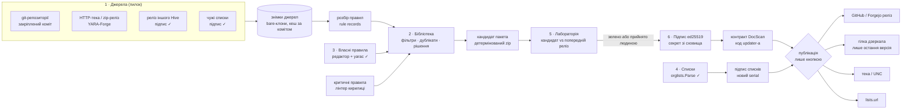

# Anthophila_Hive — план

> Статус: **погоджено 2026-11-22** з уточненнями з [PLAN-REVIEW-DOCSCAN.md](PLAN-REVIEW-DOCSCAN.md); рішення по
> питаннях Q1–Q9 і зміни плану — у розділі 9 (він має пріоритет над текстом вище).
>
> Початковий статус: **чернетка плану.** Усе нижче побудовано на `context/` (код DocScan прочитано, не
> переказано), а цифри часу — **виміряні** 2026-11-22 на цьому Mac (8 ядер) справжнім DocScan `~/yara` (4.6.0, модуль
> `docscan`) на правилах `yara-docscan-rules@0bb41fe`. Відкриті питання — у розділі 8, деякі з них блокують рішення.

---

## 0. Що з'ясувалося під час читання (впливає на план)

| # | Факт | Звідки | Наслідок для Hive |
|---|---|---|---|
| F1 | **Updater не надсилає токен для `rules.mirror.url`.** `fetch()` робить голий `http.Get`; токен (`Authorization: token …`) є лише у `fetchOpt()` для списків (`lists.token`). | `updater/update.go:105`, `updater/lists.go` | «Гілка дзеркала з токеном» для **правил** зараз не працює через HTTP. Варіанти — питання Q1. |
| F2 | `signPackage` у `cirun` приймає **лише** ключі `manifest.OfficialKeys`. | `cirun/deploy/manifest.go` | Hive не може просто перевикористати `deploy`: потрібна своя збірка, де довірені ключі = ключі робочого простору (те, що в `extra_public_keys` на ПК). |
| F3 | Версію встановлених правил ПК бере **з першого рядка `VERSION.txt`**, а не з маніфесту. | `updater/rules.go: installedRules` | Контракт: версія у `VERSION.txt` == версія маніфесту, інакше ПК перевстановлюватиме пакет щоразу або ніколи. |
| F4 | `--docscan-json` **не містить шляху файлу**; з `-r -p N` порядок рядків довільний. | замір | Лабораторія: швидкий режим — звичайний вивід `rule path` (шлях є), повний — по процесу на файл. |
| F5 | Приклад `whitelist.json`: `lnk_target` = `\\fileserver\BIN\App\Bin\App.exe` після нормалізації стає текою `…\app.exe\` і **ніколи не збігається** з ціллю `…\App.exe`. Перевірено справжнім `orglists.Decide`: `action=""`. | `lists/whitelist.json`, тест | Редактор списків Hive попереджає: «`lnk_target` схожий на файл — це тека, запис не спрацює». |
| F6 | `zipRules` бере **mtime файлів** → пакет не відтворюється побайтово. Ліцензії `LICENSE-*` потрапляють у пакет (`skipRules` пропускає лише `tools/`, `README.md`, приховані). | `cirun/deploy/rules.go` | Hive пише zip детерміновано (фіксований час з запису релізу, сортування) і зберігає `LICENSE-*`. |
| F7 | Ліміти ПК: маніфест ≤ 4 МіБ, `.sig` ≤ 4096 Б, розпаковано ≤ 4 ГіБ, у bundle — лише файли верхнього рівня ≤ 512 МіБ; списки ≤ 8 МіБ. Updater перевіряє, що **кожен** файл маніфесту є в zip і навпаки. | `update.go`, `rules.go`, `lists.go` | Усе це — пункти автоматичного контракту (розділ 6). |
| F8 | `signList` після `orglists.Parse` **перемаршалює** список (нормалізовані `sha256`, `lnk_target`) і підписує саме ці байти. | `updater/listsign.go` | Hive підписує так само: Parse → нормалізація → `MarshalIndent` + `\n` → підпис. Інакше на сервері лежатиме не те, що бачила людина. |

---

## 1. Архітектура

### 1.1. Форма

**Одна програма Go `hive`**: веб-сервер і CLI з тим самим кодом (`hive serve`, `hive import`, `hive build`,
`hive verify <bundle>`, `hive lab run`, `hive publish`). Будь-яку дію з інтерфейсу можна відтворити з консолі / CI
— це і є відтворюваність. Зовнішні залежності під час роботи: `git`, DocScan `yara`/`yarac` (шляхи в налаштуваннях),
за бажанням `gh`, `keepassxc-cli`.

### 1.2. Потік даних «пилок → мед»



### 1.3. Модулі (пакети Go)

| Пакет | Відповідальність |
|---|---|
| `internal/docscan/manifest`, `…/orglists` | **дослівні копії** з `context/docscan-go/` (змінено лише шлях імпорту); тест звіряє sha256 з оригіналом і падає, якщо DocScan оновив свій код, а копію — ні |
| `internal/docscan/install` | порт шляху встановлення updater-а: `VerifyProduct` → `stageRules`/`unpackVerified` → `compileRules`/`compileCritical` (без служб і заміни теки) — серце контракту |
| `internal/yaraexec` | єдина точка запуску DocScan `yara`/`yarac`: перевірка при старті (є модуль `docscan` і `--critical-rules`), тайм-аути, ліміти пам'яті, **білий список прапорів** — `--docscan-disarm`, `--docscan-extract`, `--docscan-backup-dir` заборонені на рівні коду |
| `internal/yaraparse` | розбір YARA: правила, `meta`, теги, `strings`, `condition`, `import`, залежності між правилами; нормалізація для дублікатів (розділ 4) |
| `internal/source` | драйвери джерел: `git`, `http-dir`, `zip-release`, `hive-release`, `lists-mirror`; знімки й різниця між ними |
| `internal/library` | записи правил, рішення (взято / відкинуто / `docscan_info` / `docscan_doc` / перейменовано + причина + хто + коли), фільтри з `build_vendor_rules.py` (платформа, старість, ліцензія YARA-Forge, DROP/INFO), дублікати |
| `internal/critical` | перевірка критичних правил (порт `deploy/critical.go`), лінтер кириличних пасток, шаблони, оцінка по категоріях (порт `eval_sensitive.py`) |
| `internal/lists` | модель і редактор списків, перевірка `orglists.Parse`, попередження (F5), хеш із завантаженого файлу, імпорт з чужого дзеркала, підпис |
| `internal/lab` | набори, прогони, порівняння з попереднім релізом, звіти, «червоні» пункти, прийняті спрацювання |
| `internal/build` | збирання `DocScan-rules.zip` / маніфесту / `.sig` / bundle (порт `deploy/rules.go` з ключами робочого простору, F2, F6) |
| `internal/publish` | GitHub/Forgejo реліз, гілка дзеркала (orphan + force-push), тека/UNC, списки; перевірка після публікації за адресою, з якої читають ПК |
| `internal/secrets` | провайдери: `keepassxc-cli`, змінні середовища, системне сховище (macOS Keychain / Secret Service / Windows Credential Manager) |
| `internal/store` | SQLite (`modernc.org/sqlite`, чистий Go — без cgo, легко зібрати під Linux/Windows) + git-репозиторії робочих просторів + сховище файлів (за sha256) |
| `internal/jobs` | фонові задачі (завантаження джерел, прогони, збирання) у SQLite; прогрес у веб через htmx/SSE |
| `internal/web` | `html/template` + htmx, статичні файли через `go:embed` |

**Чому `html/template` + htmx:** один бінарник без Node-збірки, працює без інтернету (організації з закритими
мережами), мала поверхня атаки. Редактор YARA — CodeMirror 5 (один файл, без збирача, простий режим підсвітки
YARA), вбудований у бінарник. Інтерфейс — українською; коментарі в коді — українською, ідентифікатори й тексти
помилок — англійською (як у DocScan).

---

## 2. Модель даних

Робочий простір (організація) — одиниця ізоляції: свої джерела, рішення, правила, списки, ключі, цілі.

| Сутність | Ключові поля | Де живе |
|---|---|---|
| **Workspace** | `id`, `name`, `visibility` (public / private), `rules_key` (публічний ключ + посилання на секрет), `lists_key` (окремий, як у DocScan), `targets[]`, `subscriptions[]` (чужі набори) | `hive.yaml` у git простору |
| **Source** | `id`, `type` (git / http-dir / zip-release / hive-release / lists-mirror), `url`, `ref`, `pinned` (коміт / тег / sha256 архіву), `paths[]`, `selection` (які файли), `license` (SPDX + файл), `trust_keys[]` (для hive-release / списків), `out_dir` (general / maldoc / org) | `sources/<id>.yaml` |
| **Snapshot** | `source_id`, `commit`/`sha256`, `fetched_at`, `tree_hash`, кількість правил; різниця з попереднім: правила додані / прибрані / змінені (за `body_hash`) | SQLite (+ bare-клон у кеші) |
| **Rule** (версія) | `uid` = (source, file, name), `name`, `kind` (detection / critical / policy), `file`, `tags[]`, `meta{}`, `imports[]`, `deps[]` (на які правила посилається), `text_hash`, `body_hash`, `strings_set`, `private/global`, `category` (для критичних), `classification` (public-safe / private) | SQLite (похідне: відновлюється з git і знімків) |
| **Decision** | `rule_uid`, `status` (take / drop / info / doc / rename→X), `reason`, `by`, `at`, `auto` (фільтр чи людина) | `decisions.yaml` у git (аналог DROP / INFO / RENAME) |
| **DuplicateGroup** | `level` (exact / body / similar / variant / name-clash), учасники, обраний «лишити», решта → Decision drop з причиною | SQLite; рішення — у git |
| **OwnRule** | файл `.yar` (`rules/org/` або `critical/`), тестові випадки | git |
| **TestCase** | `rule` (або набір), `expect` (match / no-match), `blob_sha256` — **посилання**, не файл | `tests/*.yaml` у git; файл — у сховищі |
| **TestSet** | `id`, `kind` (clean-corpus / malware / critical-match / critical-no-match / hostile), `blobs[]`, `confidential` | SQLite + сховище файлів (поза git) |
| **List** | `kind` (white / black), робоча копія записів, опублікований `serial`, sha256 опублікованого | `lists/*.json` у git (непідписані) + записи публікацій у SQLite |
| **LabRun** | `candidate_sha`, `baseline_release`, `yara_build_sha`, набори, час, результати по файлах, `gates[]` (red/yellow/green), `accepted[]` | SQLite + звіт JSON у сховищі (назавжди) |
| **AcceptedHit** | `rule_name`, `body_hash`, `file_sha256`, `reason`, `by`, `at` — анулюється, якщо змінилося тіло правила | git (`lab/accepted.yaml`) |
| **Release** | `version`, `workspace_commit`, `lock` (коміти всіх джерел, версії Hive / Go / yara), `created`, sha256 кожного активу, `lab_run`, `targets` + статус публікації, `signed_by` (key_id) | `releases/vX.Y.Z.lock` у git + SQLite + активи в сховищі |
| **AuditEvent** | хто / що / коли (підпис, публікація, прийняття спрацювання, зміна рішення) | SQLite (тільки додавання) |

---

## 3. Як зберігається стан і як відтворити будь-який реліз

**Гібрид: git — джерело правди для всього, що людина вирішує; SQLite — індекс і результати; сховище файлів — бінарні дані.**

```
<data>/workspaces/<ws>/            git-репозиторій простору («стільник»)
  hive.yaml  sources/  selection/  decisions.yaml
  policy/  (docscan-policy.yar, docscan-index.yar, docscan.yar — як джерело «docscan-core»)
  rules/org/*.yar  critical/*.yar  tests/*.yaml  lists/*.json  lab/accepted.yaml
  releases/vX.Y.Z.lock
<data>/cache/sources/<id>.git      bare-клони джерел (будь-який закріплений коміт доступний офлайн)
<data>/blobs/<sha256>              тестові файли, ШПЗ, активи релізів (поза git, імена = sha256, без розширень)
<data>/hive.db                     SQLite
```

- **Чому не лише SQLite:** рішення й правила мають бути видимі як diff, рецензовані, переносні; демонстрація
  «організація веде свої правила в git і пушить у свій репозиторій» — сама суть проєкту.
- **Чому не лише git:** 15 000+ записів правил, групи дублікатів, результати прогонів по тисячах файлів — це запити,
  а не файли. SQLite **повністю відновлюється** з git + знімків, крім звітів прогонів і журналу аудиту — ті також
  пишуться файлами в сховище.
- **Відтворення релізу:** `hive build --release v1.4.2` бере коміт простору й коміти джерел з `.lock`, ту саму
  дату для `VERSION.txt` і маніфесту, детермінований zip (сортування, фіксований час, F6) → **кожен файл пакета
  має той самий sha256**, що в підписаному маніфесті (`hive verify --reproduce` це звіряє). Побайтова
  ідентичність zip гарантується за тієї ж версії Hive/Go (записано в `.lock`). Справжні опубліковані байти все
  одно зберігаються в сховищі назавжди — відтворення є перевіркою, а не єдиною копією.
- **Номер версії** — більший за: усі релізи простору (БД і `releases/`) **та** те, що зараз лежить на кожній цілі
  (Hive читає маніфест з цілі перед збиранням). Втрата БД не призведе до повтору номера.

---

## 4. Пошук дублікатів і схожих правил

Розбір: `yaraparse` будує для кожного правила структуру (рядки, умова, мета). Кандидат на основу — `VirusTotal/gyp`
(парсер YARA на Go); якщо він не покриває якусь конструкцію YARA 4.x, падаємо на власний токенізер на кшталт
`split_rules()`/`mask()` з генератора. **Остаточний суддя завжди — DocScan `yarac`.**

| Рівень | Що вважається однаковим | Як рахується |
|---|---|---|
| **L0 точна копія** | однаковий текст правила | `text_hash` = sha256 тексту без коментарів, пробіли згорнуті |
| **L1 те саме тіло** | однакові `strings` + `condition`; інша назва, інший порядок рядків, інші `$`-ідентифікатори, інша `meta` | кожен рядок → канонічна форма (тип; значення: hex у нижньому регістрі без пробілів, текст з розкритими escape, regex як є; модифікатори відсортовані); ідентифікатор `$x` замінюється на хеш його канонічної форми; в умові підставляються ці хеші, операнди комутативних `and`/`or` сортуються, `them` ≡ повний набір; `body_hash` = sha256(відсортовані рядки + умова) |
| **L2 схожі** | великий спільний набір рядків | множина канонічних рядків → MinHash (128) + LSH-кошики → кандидати → точна Жаккар ≥ 0.8 (поріг у налаштуваннях). O(n) замість O(n²) на ~15 000 правил |
| **L3 варіант** | рядки ті самі (або підмножина), умова = умова іншого `and` додаткова перевірка — спрацює лише там, де вже спрацьовує базове | на L1-канонічних формах: `strings(A) ⊆ strings(B)` і `cond(B)` = `cond(A) and X` (так у генераторі відкинуто `PAExec_Cloaked`, `…_Renamed_May23`) |
| **L4 конфлікт назв** | однакова назва, різне тіло | групування за `name` у межах того, що компілюється разом (усі правила виявлення через `include` — один простір імен, тобто конфлікт = помилка компіляції; критичні — назви унікальні в усіх файлах, бо у Wazuh іде лише назва) |

Групи показуються в інтерфейсі; людина обирає, що лишити (пропозиція за замовчуванням: джерело з вищим
пріоритетом / новіша `meta.modified` / та, на яку посилаються інші правила). Решта → `Decision drop` з причиною
«duplicate of …» / «variant of …». Для L4 — пропозиція перейменування (`RENAME`). **Залежності:** правило, на яке
посилається взяте правило (або `private`/`global`), не відкидається — як у генераторі.

Окремо, як у `build_vendor_rules.py` (переноситься на Go з тестом на збіг результату):
- **платформа** — за `condition` (ELF / Mach-O / DEX / Java class), назвою (Linux / ESXi / мережеві пристрої / серверне ПЗ), webshell-ознаками;
- **старі** — `meta` дата ≤ `OLD_YEAR`;
- **повільні** — `yarac` **без** `-w` (ловимо попередження «slowing down scanning»), плюс замір часу скану: кожен файл джерела компілюється у своєму namespace і проганяється на фіксованій вибірці; регрес → бісекція до правила;
- **хибні** — нові спрацювання на чистому корпусі (лабораторія) і результати `fp_scan.ps1` з чистої Windows (імпорт `hits.txt`).

---

## 5. Тестова лабораторія

### 5.1. Набори

| Набір | Приклад того, що вже є | Правило зберігання |
|---|---|---|
| чистий корпус | `~/docscan-ci/assets` (4 539 файлів, 1,6 ГБ: pdf, rtf, lnk, xls/x, doc/x, ppt) + документи організації | сховище, імена = sha256; конфіденційні набори позначаються, ніколи не публікуються |
| ШПЗ | `~/docscan-ci/malware` (969 файлів, 1,2 ГБ) | окремий том `noexec,nosuid`, файли `0400`, **без розширень**, лише читання для процесу лабораторії; в інтерфейсі не завантажуються назад (хіба zip з паролем `infected`) |
| критичні | `docscan-critical/tests/match` (263), `no-match` (205); синтетика `gen_sensitive_dataset.py` з `expected.tsv` | сховище; у git — лише списки sha256 |
| зламані / ворожі | обрізані, рекурсивні zip, фузинг-корпус | сховище |

Git-писар Hive відмовляється комітити бінарні файли, файли з сигнатурами PE/OLE/ZIP і будь-що зі сховища (плюс
`.gitignore`). На Linux прогін іде в пісочниці (`bwrap`/`nsjail`: без мережі, файлова система лише на читання), на
macOS — `sandbox-exec`. ШПЗ ніколи не запускається: Hive відкриває ці файли лише через `yara`, а Windows PE на
macOS/Linux і не запуститься.

### 5.2. Прогін

1. Кандидат пакета і базовий реліз (попередній опублікований з цієї цілі) компілюються `yarac` у `.yarc`.
2. **Швидкий режим** (для кожної зміни): `yara -w --file-vars -r -p N -C <yarc> <набір>` — вивід `правило шлях`
   (F4), окремо `--critical-rules` для третього проходу. Вердикт відновлюється з політики: правила `DS_*` мають
   `meta.severity`, теги `docscan_info`/`docscan_doc` — як у watcher.
3. **Повний режим** (перед релізом): по одному процесу `yara --docscan-json -C <yarc> <файл>` на файл, пул N
   процесів — так само, як працює watcher; дає й збіги другого проходу (VBA, частини документа).
4. Результати кешуються за ключем `(sha пакета, sha файлу, sha бінарника yara)` — базовий реліз на тих самих
   файлах не переганяється вдруге.

### 5.3. Порівняння і червоні пункти

| Пункт | Червоне, якщо |
|---|---|
| компіляція | помилка `yarac`; попередження «slow» у **нових/змінених** правилах |
| хибні | нове спрацювання (правило × файл) на чистому корпусі, якого не було в базовому і яке не прийняте |
| втрачені виявлення | файл ШПЗ, який базовий реліз виявляв, а кандидат — ні (і окремо — по правилах) |
| критичні | будь-який `tests/match` не в черзі або `tests/no-match` у черзі (як `cirun`); по категоріях: знайдено / пропущено / хибні — пороги жовтого в налаштуваннях |
| швидкість | загальний час скану гірший за базовий на > X % (жовте) / > Y % (червоне) |
| ворожі файли | падіння / тайм-аут `yara` |
| публічна ціль | у пакет потрапляє критичне правило з позначкою `private` або лінтер знайшов IP / імена серверів / заборонені назви зі словника організації |
| контракт | будь-який пункт розділу 6 |

Реліз заблокований, поки є червоне. Людина може **прийняти** конкретне спрацювання (правило + тіло + файл) з
причиною; прийняття зберігається в git і анулюється, коли правило змінюється. Кожен звіт прогону зберігається
назавжди і прив'язується до релізу.

### 5.4. Скільки це триває (виміряно, Mac 8 ядер)

| Що | Обсяг | Час |
|---|---|---|
| компіляція всіх правил (`yarac`, ~8 000 правил, `.yarc` 25 МБ) | — | **0,9 с** |
| швидкий режим, усі правила + третій прохід | 4 539 документів, 1,6 ГБ | **16 с** |
| швидкий режим | 969 зразків ШПЗ, 1,2 ГБ | **4,6 с** |
| повний режим (`--docscan-json`, процес на файл, `-C`) | 400 документів | 13,9 с → **~35 мс/файл** |
| те саме, але правила з джерел без `-C` | 400 документів | 50 с — тому завжди `.yarc` |

**Оцінка на ~5 000 документів + ~1 000 ШПЗ + 468 критичних**, кандидат + базовий:
швидкий режим — **≈ 1 хв**; повний — **≈ 7–8 хв** (з кешем базового — удвічі менше). Застереження: на Windows
`yara64` працює через пісочницю broker/worker — там повільніше; Windows-стенд потрібен для остаточної перевірки
(етап 4), не для щоденної роботи.

---

## 6. Контракт з DocScan: що перевіряється, щоб ПК гарантовано прийняли пакет

Виконується автоматично після кожного збирання і **ще раз після публікації** (завантаження за тією самою адресою і
тим самим способом, яким читають ПК).

**Пакет правил**
1. Структура zip: `docscan-index.yar` у корені; усі шляхи `manifest.SafePath`; без повторів; `critical/` — лише
   файли верхнього рівня за `^[A-Za-z0-9][A-Za-z0-9_.-]{0,99}\.yar$`, 1..256; `LICENSE-*` джерел присутні.
2. `VERSION.txt`: перший рядок `DocScan rules vX.Y.Z (commit …, critical …: N files, YYYY-MM-DD)` і
   `manifest.VersionFromTitle(рядок) == manifest.version` (F3).
3. Маніфест: `schema` 1, `product` `docscan-rules`, `vX.Y.Z`, `package` (ім'я без `/`, розмір, sha256),
   `files` == точний вміст zip (обидва напрямки); `Check()`; ≤ 4 МіБ; `MarshalIndent` + `\n`.
4. Підпис: `manifest.VerifyProduct` (той самий код) ключем простору; цей ключ позначено як розгорнутий на ПК
   (`extra_public_keys`); `.sig` ≤ 4096 Б.
5. Шлях встановлення updater-а (`internal/docscan/install`): розмір і sha256 пакета → розпакування з перевіркою
   кожного файлу (≤ 4 ГіБ) → `yarac -w -d filename= -d filepath= -d extension= -d filetype= -d owner=
   docscan-index.yar` з теки пакета → `yara -w --critical-rules=<critical> --critical-out=… empty.yar probe.txt`
   без рядків `error`.
6. Bundle: рівно три файли верхнього рівня, кожен ≤ 512 МіБ; `hive verify DocScan-rules-bundle.zip` проходить як
   `installRulesFile`.
7. Версія: строго більша за версію на цілі (ПК не ставлять старішу і рівну).
8. Етап 4: справжній `docscan-updater.exe -InstallRules <bundle>` на Windows-стенді з `extra_public_keys`
   простору (питання Q9).

**Списки**
1. `orglists.Parse(байти, kind)` — той самий код; `serial` > опублікованого на цілі; `serial` = UTC
   `YYYYMMDDhhmmss` (щонайменше старий + 1); ≤ 8 МіБ.
2. Підписуються саме нормалізовані байти (F8); `.sig` перевіряється `manifest.VerifySig` ключем списків.
3. Попередження (не блокують): F5, маски білого списку без `sha256`/`lnk_target`, дублікати записів, записи, що
   перекриваються білим і чорним.

---

## 7. Етапи

| Етап | Що | Критерій готовності |
|---|---|---|
| **0. Каркас** (1–2 дні) | модуль Go, `yaraexec` з перевіркою бінарника, копії `manifest`/`orglists` з тестом звірки, `internal/docscan/install`, `hive verify` | `hive verify` на справжньому останньому релізі `yara-docscan-rules` — зелено; на зіпсованих копіях (змінений файл, чужий ключ, стара версія, VERSION.txt ≠ маніфест) — червоно |
| **1. MVP** | див. нижче | див. нижче |
| **2. Джерела** | порт `build_vendor_rules.py` на Go; знімки джерел і різниця по правилах; імпорт історії `vendor-report.md` з git-історії; L2/L3 дублікати; ліцензії; реліз на GitHub/Forgejo | Hive з тих самих закріплених комітів генерує `general/`, `maldoc/`, `file-index.yar`, `vendor-report.md`, **ідентичні** нинішнім у `yara-docscan-rules` |
| **3. Організації** | кілька просторів; підписка на підписаний реліз іншого простору / Hive + свої правила поверх; імпорт чужих списків з перевіркою підпису; свої ключі й цілі | демо: публічний простір «Anthophila» + приватний «org-example», що підтягує публічний набір, додає свої критичні правила й списки і пушить у своє дзеркало |
| **4. Лабораторія повністю** | повний режим JSON; агент на Windows-стенді (fp_scan, справжній `-InstallRules`); профілювання повільних правил; оцінка по категоріях; користувачі й ролі (редактор / рецензент / публікатор, «чотири ока» на публікацію) | реліз з зеленим звітом, встановлений справжнім updater-ом на ВМ |

**Що буде в MVP (етап 1):**
- Один робочий простір в інтерфейсі (модель даних — одразу багатопросторова), один користувач, `127.0.0.1`.
- Імпорт: `yara-docscan-rules` **як є** (згенероване дерево як джерело), `docscan-critical`, `whitelist.json` /
  `blacklist.json`.
- Бібліотека: перегляд і пошук правил, рішення з причинами, дублікати L0/L1/L4.
- Редактор YARA: компіляція DocScan `yarac`/`yara` на кожне збереження, лінтер кирилиці для критичних, два
  шаблони («знайшли ШПЗ», «вид критичної інформації»), тестові файли match / no-match до кожного правила.
- Списки: редактор, перевірка, попередження, sha256 із завантаженого файлу, підпис.
- Лабораторія: швидкий режим, порівняння з попереднім релізом, червоні пункти, прийняття спрацювань, звіти.
- Збирання + підпис + контракт; публікація: **гілка дзеркала** (orphan), **тека/UNC**, **списки** — кнопкою з
  підтвердженням.
- Секрети: змінні середовища, `keepassxc-cli`, macOS Keychain.
- **Приймальний тест MVP:** пакет Hive з тих самих комітів має **той самий набір файлів з тими самими sha256**, що й
  `cirun rules-release --dry-run` (крім `VERSION.txt`), і проходить контракт.

### Публікація в гілку дзеркала — чому orphan + force-push

Кожна публікація — **новий коміт без батьків** з трьома файлами (`DocScan-rules.zip`, `rules-manifest.json`,
`rules-manifest.sig`) і `git push --force-with-lease` у гілку (наприклад `docscan-rules`). Гілка завжди має один
коміт; старі архіви стають недосяжними й прибираються збирачем сміття сервера; клон дзеркала лишається
малим.
- Звичайні коміти: кожен реліз додає кілька МБ стиснутого zip, які git майже не стискає дельтами → репозиторій
  росте безкінечно.
- Git LFS: сирий URL віддає файл-вказівник замість zip → ПК побачить чужий sha256. Не підходить.
- Історія не губиться: усі релізи з `.lock` і активами — у Hive, теги — у репозиторії простору.
- Вимога до сервера: дозволити force-push у цю гілку лише ключу розгортання Hive.
- Перехідний стан (ПК узяв маніфест нового коміту, а zip — старого, або кеш CDN GitHub ~5 хв) дає невідповідність
  sha256 → ПК нічого не ставить і повторює пізніше. Безпечно завдяки підпису.

Адреси для ПК: Forgejo `https://<host>/<org>/<repo>/raw/branch/docscan-rules`, GitHub
`https://raw.githubusercontent.com/<org>/<repo>/docscan-rules`. **Токен для правил — див. Q1.** Списки
публікуються так само (окрема гілка/тека), `lists.token` updater підтримує.

### Секрети

- Ключ підпису (seed ed25519) читається зі сховища **у момент підпису**, після явної дії людини, тримається лише в
  пам'яті й затирається; Hive перевіряє, що публічна частина = ключ простору.
- Токени git передаються дочірньому `git` через `GIT_ASKPASS`-помічник (лише середовище процесу), ніколи в URL
  remote чи `.git/config`.
- Журнал проходить через фільтр, що замінює відомі значення секретів на `***`.
- Публікація в будь-яку ціль, а в публічну — обов'язково, тільки кнопкою людини з підтвердженням (показується
  ціль, версія, різниця з попереднім релізом); CLI вимагає інтерактивного `--confirm`.

---

## 8. Ризики й відкриті питання

### Питання, що блокують рішення

- **Q1. Закрите дзеркало правил (F1).** Updater не надсилає токен для `rules.mirror.url`. Що обираємо без зміни
  DocScan?
  - (а) **UNC-шара з ACL** — працює вже зараз; Hive публікує туди (і за бажанням ще й у гілку для історії/огляду);
  - (б) **`https://reader:<token>@host/…`** — Go сам ставить Basic-авторизацію з URL, `checkSource` таке приймає,
    Forgejo приймає токен як пароль. Але адреса з токеном потрапить у журнал updater-а
    (`rules … from <url>`) і в текст помилок → у Wazuh. Потрібен токен лише на читання одного репозиторію;
  - (в) внутрішній HTTP без авторизації — підпис захищає від підміни, але критичні правила зможе прочитати будь-хто
    в мережі;
  - (г) додати токен у `updater` — це зміна DocScan, за завданням заборонена; лише записати як пропозицію.
  Моя рекомендація: (а) для приватних наборів, публічна гілка без токена — для публічних.
- **Q2. Ключі.** Публічний простір «Anthophila» підписує **новим** ключем (тоді на ПК зі стандартним конфігом його
  треба додати в `extra_public_keys`) чи ключем CI DocScan (тоді Hive фактично замінює `cirun rules-release` для
  `yara-docscan-rules`)?
- **Q3. Hive замінює `cirun rules-release` чи працює поруч?** CI програми (`rulesrc`) бере релізи з GitHub
  `yara-docscan-rules` — їх лишаємо там у будь-якому разі.
- **Q4. Номери.** ПК організації, що перейшла з офіційних релізів на свої, приймуть лише версію, **більшу** за
  встановлену офіційну. Пропоную: перша версія простору = max(остання офіційна, те, що на цілі) + bump. Згодні?

### Питання, що впливають на обсяг

- **Q5.** Де працює Hive: сервер у мережі організації (тоді багатокористувацький режим потрібен раніше) чи на
  машині адміністратора? Для MVP пропоную другий варіант.
- **Q6.** Чи можна взяти `~/docscan-ci/assets`, `~/docscan-ci/malware`, `~/docscan-ci/seeds`,
  `~/docscan-test-dataset*` як початкові набори лабораторії (лише посиланням/копією у сховище, не в git)?
- **Q7.** Мова коментарів у коді: пропоную українську (як у DocScan), а ідентифікатори й тексти помилок —
  англійською. Ок?
- **Q8.** Приклад `whitelist.json` (F5) — це помилка прикладу чи очікувалась інша семантика `lnk_target` (файл, а
  не тека)? Hive лише попереджатиме; виправляти DocScan не буду.
- **Q9.** Чи має `docscan-updater -InstallRules` спосіб вказати тимчасову `InstallDir` (для тесту на стенді без
  чіпання встановленого DocScan)? Чи можна використати наявні Forgejo-стенди (Win11 / Server 2019) як Windows-агент
  лабораторії?

### Ризики

| Ризик | Що робимо |
|---|---|
| Порт генератора з Python на Go дасть інший результат | тест на ідентичність з нинішнім `yara-docscan-rules` — умова завершення етапу 2; до того джерело імпортується як готове дерево |
| `gyp` не розбере якусь конструкцію YARA 4.x / модуль `docscan` | запасний токенізер; компіляція — завжди DocScan `yarac` |
| macOS/Linux `yara` поводиться не так, як Windows `yara64` (пісочниця, шляхи) | щоденно — macOS/Linux; перед релізом — Windows-агент (етап 4) |
| Копії `manifest`/`orglists` відстануть від DocScan | тест звірки sha256 з `context/` (або з чекаута `yara-docscan`) |
| Витік конфіденційних документів / ШПЗ у git | сховище поза git, перевірка git-писаря, позначка `confidential`, публічні цілі не отримують нічого з приватних наборів |
| Критичне правило з внутрішньою назвою в публічному пакеті | класифікація `private` за замовчуванням для нових критичних правил; лінтер словника організації; червоний пункт для публічних цілей |
| Сервер забороняє force-push | окрема гілка з дозволом лише для ключа Hive; інакше — реліз або UNC |

---

## 9. Рішення після відгуку DocScan (2026-11-22)

Джерело: [PLAN-REVIEW-DOCSCAN.md](PLAN-REVIEW-DOCSCAN.md). Цей розділ має пріоритет над текстом вище.

### 9.1. Відповіді на питання

| # | Рішення |
|---|---|
| Q1 | DocScan додає `rules.mirror.token` (`updater.json`) і `-RulesToken` (інсталятор); Hive DocScan не змінює. Приватні набори — гілка дзеркала з токеном лише на читання **після** виходу цієї зміни; до того — UNC-шара з ACL. `https://user:token@…` — **заборонено** (Hive відмовляє в такій адресі цілі). Публічні набори — гілка без токена. |
| Q2 | Офіційний `yara-docscan-rules` — ключ CI DocScan (`manifest.OfficialKeys`). Кожен простір організації — свій ключ (на ПК — `extra_public_keys`). Ключ списків — окремий (`lists.public_keys`). |
| Q3 | Спершу поруч із `cirun rules-release`; після етапу 2 (ідентичний пакет) Hive замінює його для `yara-docscan-rules`. `cirun/rulesrc` не змінюється. |
| Q4 | Перша версія простору = max(остання офіційна, версія на цілі) + bump. |
| Q5 | MVP — машина адміністратора, `127.0.0.1`, один користувач; модель даних багатопросторова. |
| Q6 | Набори `~/docscan-ci/assets`, `malware`, `seeds`, `~/docscan-test-dataset*` — посиланням або копією у сховище, ніколи в git. **Не брати** `yara-docscan/docscan-project/test-samples/provided/` (семпли замовника). |
| Q7 | Коментарі українською, ідентифікатори й тексти помилок англійською. |
| Q8 | Помилка прикладу: `lnk_target` — тека-префікс. Приклад у `context/lists/whitelist.json` виправлено на `\\fileserver\BIN\App\`. Попередження редактора лишається. |
| Q9 | `docscan-updater.exe -InstallRules <bundle> -InstallDir <тимчасова тека>` (у ній `bin\yarac64.exe`, `bin\yara64.exe`); стенди Win11 / Server 2019 — Windows-агент лабораторії. |

### 9.2. Зміни плану

1. **MVP ділиться на два кроки:**
   - **MVP-a:** імпорт (`yara-docscan-rules` як є, `docscan-critical`, списки), бібліотека з рішеннями, редактор з
     компіляцією, списки з підписом, збирання, контракт, публікація (гілка дзеркала, тека/UNC, списки);
   - **MVP-b:** лабораторія (швидкий режим, порівняння з попереднім релізом, червоні пункти, прийняття
     спрацювань) і дублікати L0/L1/L4.
2. **`docscan-policy.yar` — файл DocScan, не звичайне правило:** редагування лише з окремим підтвердженням;
   обов'язковий тест вердиктів на еталоні `yara-docscan/docscan-project/ci/expected-verdicts.tsv`
   (`check_verdicts.py`) на зразках `test-samples/generated/` — червоний пункт, якщо політика змінилася.
3. **Контракт, `critical/`:** 1..256 файлів **і не більше 64 МБ разом** (обмеження `yara --critical-rules`).
4. **Назви критичних правил** унікальні в усіх файлах `critical/` — червоний пункт контракту.
5. **Цілі з токеном:** у налаштуваннях цілі — мінімальна версія DocScan на ПК, що підтримує
   `rules.mirror.token`; публікація приватного набору в гілку з токеном блокується, поки ціль не підтверджує, що ПК
   мають таку версію (номер версії DocScan з'явиться з релізом програми).

---

## 10. Стан реалізації

| Етап | Стан | Примітки |
|---|---|---|
| 0. Каркас | **готово** 2026-11-22 | `hive verify`; справжній реліз v1.0.0 — PASS; 20 видів псування — FAIL у своїй перевірці |
| MVP-a | **готово** 2026-11-22 | приймальний тест: 1 667 файлів = офіційний v1.0.0; справжній прогін (`yara-docscan-rules@0bb41fe` + `docscan-critical`, 468 документів) — PASS за ~5 с; публікація в теку, списки, відтворення — перевірено |
| MVP-b | **готово** 2026-11-22 | справжній прогін: 4 539 документів + 959 ШПЗ + 181 розмічений, кандидат і базовий у пісочниці — ~50 с (fast), ~2,5 хв (full; план оцінював 7–8 хв); дублікати: 223 групи L1 у `yara-docscan-rules` |
| 2. Джерела | **готово** 2026-11-22 | генератор на Go = Python байт у байт (1 665 файлів); пакет з 8 вендорних джерел = офіційний v1.0.0 (1 667 файлів); оновлення джерела з різницею по правилах; історія звітів; L2 / L3; реліз GitHub / Forgejo |
| 3–5 | див. розділ 11 | етапи перебудовано після уточнення: Hive — сервер організації |

Відхилення від плану в MVP-a (свідомі):
- веб-інтерфейс без htmx і CodeMirror: звичайні форми, нуль JavaScript (CSP `script-src 'none'`); редактор —
  textarea з перевіркою DocScan на кожне «Перевірити / Зберегти». Підсвітку можна додати пізніше;
- одне джерело-дерево правил на простір (готове дерево на кшталт `yara-docscan-rules`); вендорні джерела з
  фільтрами генератора — етап 2;
- реліз на GitHub / Forgejo (`gh release`) — етап 2; у MVP-a — тека / UNC і гілка дзеркала;
- файл власних правил з помилками компіляції не зберігається (простір завжди компілюється).

Знахідки MVP-b:
- **223 точні дублікати (L1) в офіційному наборі:** правила signature-base / FireEye / Volexity, які YARA-Forge
  поставляє вдруге під іншою назвою (`VOLEXITY_…`, `FIREEYE_RT_…`). Генератор їх не бачить: порівнює лише однакові
  назви. Прибирання копій з `general/yara-rules-core.yar` не змінило жодного виявлення на 959 зразках ШПЗ і
  жодного результату на 4 539 чистих документах (лабораторія — зелена).
- **Вивід yara читати окремо stdout і stderr.** Stdout буферизований блоками, stderr — ні; в одному буфері рядок
  stderr вклинювався посеред рядка stdout, і рядки «правило шлях» губилися (по 1–2 на прогін, щоразу інші) —
  лабораторія показувала фантомні «нові спрацювання» і «втрати». Виправлено в `yaraexec`.
- **Індекс старого формату** (без хешів дублікатів) зливав бібліотеку в одну «групу» — масове відкидання
  прибрало б 1 253 правила. Тепер: Hive сам перебудовує застарілий індекс, порожній хеш ніколи не групується,
  масове відкидання спершу показує план і вимагає ввести кількість.
- Розмічений набір `docscan-test-dataset-v2` критичні правила `zsu.yar` не покривають (усі категорії — «пропущено»):
  для нього потрібні правила організації (приклад — `org-rules-example.yar`).

Знахідки етапу 2:
- **Генератор Hive = Python-генератор байт у байт** на всіх 1 665 файлах (general/, maldoc/, file-index.yar,
  LICENSE-*, vendor-report.md). Для цього відтворено поведінку Python: універсальні переноси рядків, заміна
  невалідного UTF-8 як `decode(errors="replace")`, `\s` Unicode, зрізи з кінцем перед початком.
- **Правила InQuest у файлах `.rule` (18 правил)** Hive спершу не вважав правилами: бібліотека, дублікати й
  лабораторія їх не бачили (у пакет вони потрапляли). Лабораторія через це не враховувала їхніх спрацювань:
  після виправлення — 467 виявлених зразків ШПЗ з 959 замість 448. Версія індексу піднята — старі індекси
  перебудовуються самі.
- **Оновлення signature-base до upstream** (перегляд, не закріплено): ~340 змінених правил у вибраних файлах,
  43 нові файли-кандидати; кількість правил у згенерованому наборі не змінюється.
- **L2 / L3 в офіційному наборі:** 20 груп схожих правил, 17 пар «варіант» (напр. `APT_Backdoor_Win_GORAT_3` —
  варіант `GORAT_2`; `Windows_VulnDriver_Phoenix` — варіант `Windows_VulnDriver_Agent64`).

---

## 11. Уточнення: Hive — сервер організації (2026-11-22)

Кожна організація розгортає **власний** Anthophila_Hive на своєму сервері й керує правилами **через веб-інтерфейс**
(кілька людей, мережа організації). Це замінює рішення Q5 («машина адміністратора, 127.0.0.1, один користувач»).

| Питання | Рішення |
|---|---|
| Розгортання | **Linux + Docker**: один образ — Hive + DocScan `yara` / `yarac` для Linux; дані (`/data`: БД, git просторів, сховище наборів, кеш) — на томі; оновлення — новим образом; пісочниця для наборів — `bwrap` у контейнері |
| Вхід | **локальні облікові записи** в Hive: пароль (argon2id) + TOTP за бажанням; ролі — переглядач, редактор, рецензент, публікатор, адміністратор; LDAP / AD — пізніше як додатковий спосіб |
| Секрети | **зашифровано, розблоковує людина**: ключ підпису правил, ключ списків і токени — у сховищі Hive, зашифровані паролем (age / scrypt); публікатор вводить пароль у веб на час підпису / публікації; відкритим ключ на диску не лежить ніколи, у пам'яті — лише на час дії |
| Доступ | HTTPS (власний сертифікат або за reverse proxy), CSRF, сесії з терміном, журнал входів і дій |
| Публікація | «чотири ока»: реліз публікує публікатор, але не той, хто його зібрав (налаштовується); публічні цілі — лише після схвалення рецензента |
| CLI | для адміністратора сервера (`docker exec`): створити першого адміністратора, резервна копія, перевірка пакета |

Зроблене на етапах 0–2 (збирання, підпис, контракт DocScan, лабораторія, генератор, публікація) не змінюється —
змінюється обгортка: доступ, користувачі, секрети, розгортання.

### Етапи після уточнення

| Етап | Що | Стан |
|---|---|---|
| 0, 1a, 1b, 2 | каркас, MVP-a, MVP-b, вендорні джерела | готово |
| **3. Сервер організації** | Docker-образ (Hive + DocScan yara для Linux, bwrap), користувачі й ролі, вхід (пароль + TOTP), зашифроване сховище ключів з розблокуванням у веб, HTTPS, «чотири ока», усі дії — у веб (зокрема те, що зараз лише в CLI), резервна копія / відновлення | **готово** 2026-11-22; збирання Docker-образу не перевірено (немає Docker на машині розробки) |
| **4. Свій набір поверх чужого** | підписка на підписаний реліз (публічний Anthophila / DocScan) як джерело, свої правила й критичні поверх, імпорт чужих списків з перевіркою підпису; демо: публічний Hive + Hive організації | |
| **5. Повна лабораторія** | Windows-агент (Win11 / Server 2019): справжній `docscan-updater -InstallRules`, `fp_scan` на чистій Windows; профілювання повільних правил | |

---

## 12. Майбутні завдання

### 12.1. Правила для macOS і Linux (DocScan для інших ОС) — заплановано 2026-11-22

**Контекст.** DocScan планують доопрацювати для macOS і Linux. Зараз генератор вендорних правил (порт
`build_vendor_rules.py`, `internal/vendor`) і весь пакет розраховані лише на Windows-ПК: правила, що не можуть
спрацювати на Windows, **відкидаються** (`platformReason`: лише ELF, лише Mach-O, Android, Linux / ESXi / macOS за
назвою, вихідні коди webshell, мережеві пристрої й серверне ПЗ без перевірки PE). Для ПК з macOS і Linux саме ці
правила потрібні.

**Що зробити (чернетка, уточнити з командою DocScan):**

1. **Цільова платформа** простору / пакета: `windows` (як зараз), `linux`, `macos`; простір може збирати кілька
   пакетів — по одному на платформу.
2. **Генератор з платформою.** `platformReason(fname, rule, platform)` замість однієї Windows-логіки:
   - `windows` — як зараз (**пакет має лишитися байт у байт таким самим** — тест `TestParityWithPython`);
   - `linux` — брати ELF, правила Linux / ESXi / webshell (сервери), скрипти (`sh`, `py`, `perl`); PE-правила — за
     рішенням (файлові сервери з Windows-файлами);
   - `macos` — брати Mach-O / fat binaries, правила macOS; ELF / Android — відкидати.
   DROP / INFO / OLD_YEAR — спільні, плюс платформні доповнення в `vendor/config.yaml`; звіт генератора — окремий
   для кожної платформи.
3. **Пакет на платформу.** Окремий `DocScan-rules-<платформа>.zip` з власним маніфестом (продукт, напр.
   `docscan-rules-linux`) або одна точка входу на платформу в спільному пакеті — **залежить від того, як DocScanUpdater
   для macOS / Linux шукатиме й перевірятиме пакет** (`manifest.ProductRules`, шлях встановлення, назви `yara` /
   `yarac`, зовнішні змінні). Контракт (`internal/contract`, `internal/docscan/install`) — порт шляху встановлення
   updater-а саме цієї ОС.
4. **Бібліотека й рішення.** Статус правила — на платформу (взято на Linux, відкинуто на Windows …); рішення
   людини — з платформою або для всіх; фільтр бібліотеки за платформою.
5. **Лабораторія.** Набори з платформою (ELF-зразки, Mach-O-зразки, чисті файли Linux / macOS); DocScan `yara` для
   цієї ОС; пункти G1–G7 — для кожного пакета окремо.
6. **Критичні правила.** Текст документа той самий; перевірити, що третій прохід на macOS / Linux дає ту саму
   нормалізацію (регістр, пробіли, кирилиця).
7. **Списки.** Формат `orglists` зараз Windows-шляхи (`C:\…`, `\\server\share\`, `lnk_target` для `.lnk`): потрібні
   POSIX-шляхи (`/home/*/Downloads/**`), а замість `.lnk` — що буде на macOS / Linux (`.desktop`, alias, symlink) —
   **лише після того, як це визначить DocScan** (Hive перевіряє списки тим самим кодом, що й ПК).
8. **Цілі публікації й ПК** — окремі теки / гілки на платформу; розділ 11 документації — приклади `updater` для
   macOS / Linux.

**Питання до DocScan (до початку робіт):** назви продуктів у маніфесті для macOS / Linux; один пакет чи окремі;
шлях встановлення й перевірка на ПК (той самий `stageRules`?); яка пісочниця й які зовнішні змінні; формат списків
для POSIX-шляхів і що замість `.lnk`.

**Умова готовності:** Windows-пакет не змінився (паритет з Python і з офіційним релізом); пакет Linux / macOS проходить
контракт, перенесений з updater-а цієї ОС; лабораторія на платформних наборах — зелена.
